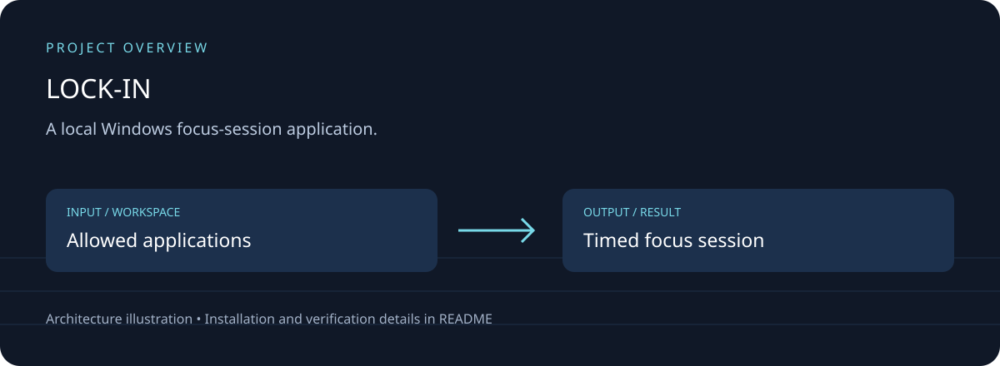

# LOCK-IN

## Download, setup and project overview

A local Windows focus-session application.

Application allow-list; timed sessions; restart recovery; local progress; installer source.



[Download source ZIP](https://github.com/ahpa5246-lgtm/LOCK-IN/archive/refs/heads/main.zip) · [Changes and branches](https://github.com/ahpa5246-lgtm/LOCK-IN/branches) · [Verification notes](docs/QUALITY_REVIEW.md)

The ZIP contains source code. Installation steps and external runtime requirements are listed below.

```bash
git clone https://github.com/ahpa5246-lgtm/LOCK-IN.git
cd LOCK-IN
```

From the repository directory:

```text
# Run on Windows; review the existing recovery instructions first.
dotnet restore
dotnet test -c Release
```

The diagram is a project illustration. Test results and runtime limitations are recorded in [the review](docs/QUALITY_REVIEW.md); it is not a production-readiness certification.


LOCK-IN is a free, local-first Windows focus app that turns a study session into a deliberate allow-list: choose the apps you need, choose a duration, then start the mission. While the session is active, distracting interactive apps are closed automatically.

The project is intentionally built as a focus tool, not anti-tamper software. Strict Mode removes the in-app escape hatch for the chosen period, persists the session across restarts, and starts enforcing again when LOCK-IN is reopened. Windows safety and user control come first: critical system processes and Task Manager are never targeted.

## Highlights

- Allow-list focus sessions for Windows desktop apps
- Strict Mode with no in-app early-exit button
- Crash/restart recovery through persisted session state
- Boss-health progress meter and XP/streak statistics
- Local-only data in %LocalAppData%\LOCK-IN
- Optional Start with Windows setting
- No accounts, ads, telemetry, cloud service, or subscription
- Self-contained Windows x64 publishing
- CI, unit tests, release workflow, and Inno Setup installer

## Requirements

- Windows 10 22H2 or Windows 11
- x64 CPU
- No .NET installation is required for release builds

## Run from source

    dotnet restore
    dotnet build -c Release
    dotnet test -c Release
    dotnet run --project src/LockIn.App/LockIn.App.csproj

## Build a portable release

    dotnet publish src/LockIn.App/LockIn.App.csproj -c Release -r win-x64 --self-contained true -o artifacts/publish

The app is configured as a self-contained single-file publish.

## How enforcement works

LOCK-IN scans processes in the current Windows session. It only considers processes with an interactive top-level window. Apps not included in the session allow-list are terminated, except for a conservative set of Windows shell, security, accessibility, and recovery processes.

This design deliberately avoids kernel drivers, service tampering, policy modification, and attempts to disable Windows recovery tools.

### Important limitation

A local administrator can always defeat a user-mode focus application. LOCK-IN is designed to remove casual escape routes and add commitment friction, not to take control away from the device owner.

## Release

Push a tag such as v1.0.0. The release workflow tests the solution, publishes the self-contained build, creates a portable ZIP, builds an Inno Setup installer, and creates the GitHub Release.

## Security and privacy

See SECURITY.md. LOCK-IN does not transmit usage data anywhere.

## License

MIT.
